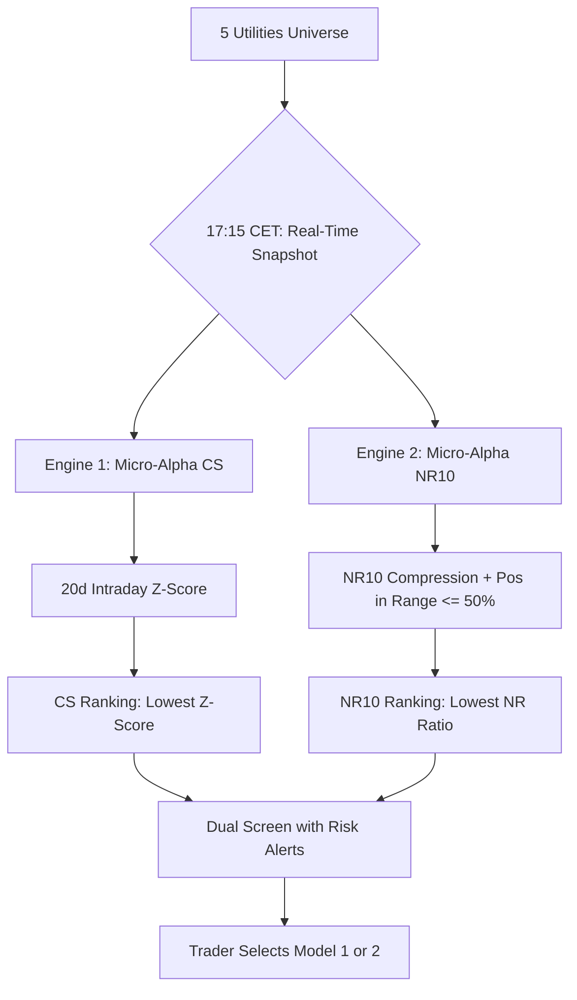
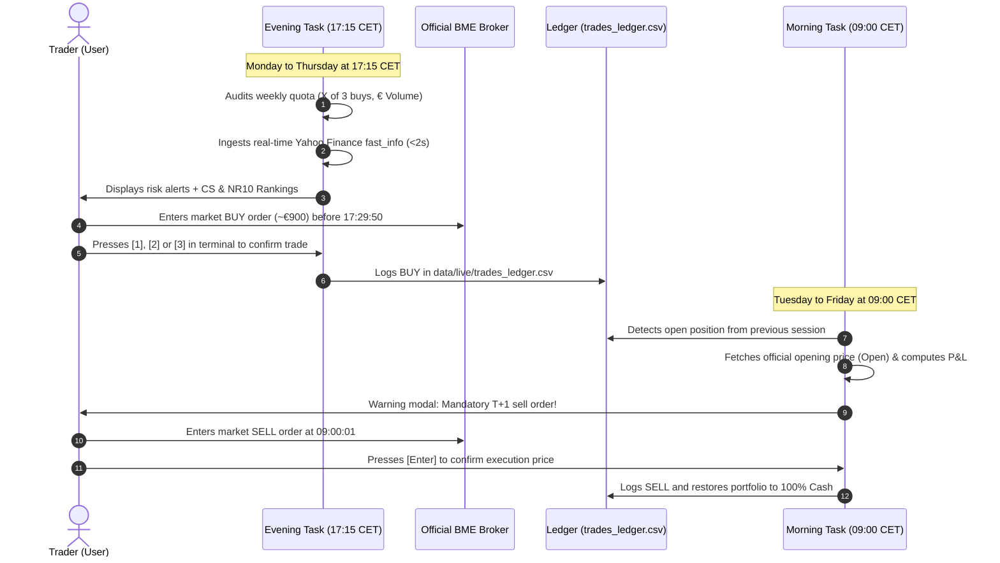

# BME Algorithmic Trading Contest Framework & Live Execution Engine
> **Madrid Stock Exchange (Bolsa de Madrid - BME) Investment Competition — October / November 2026**  
> *Quantitative Architecture, Rolling Simulation Engine, and Real-Time Production Execution System.*

---

## 📑 Table of Contents
1. [Executive Summary & Core Thesis](#-1-executive-summary--core-thesis)
2. [Regulatory Framework & Quantitative Design](#-2-regulatory-framework--quantitative-design)
   - [Official BME Scoring Asymmetry & Cross-Sectional Dependency](#official-bme-scoring-asymmetry--cross-sectional-dependency)
   - [The 5 Ultra-Low Variance Utilities Universe](#the-5-ultra-low-variance-utilities-universe)
   - [Surgical Position Sizing (€900)](#surgical-position-sizing-900)
   - [The Grace Period Exemption Clause (October 13 to 21)](#the-grace-period-exemption-clause-october-13-to-21)
3. [The Two Live Quantitative Strategies](#-3-the-two-live-quantitative-strategies)
   - [Engine 1: Micro-Alpha CS (Cross-Sectional Reversion)](#engine-1-micro-alpha-cs-cross-sectional-reversion)
   - [Engine 2: Micro-Alpha NR10 (Narrow Range 10 Compression)](#engine-2-micro-alpha-nr10-narrow-range-10-compression)
4. [Risk Calendar & Event Alert Module](#-4-risk-calendar--event-alert-module)
   - [Macroeconomic Alerts (Central Banks)](#macroeconomic-alerts-central-banks)
   - [Corporate Alerts (9M Earnings & Dividends)](#corporate-alerts-9m-earnings--dividends)
   - [Principle of Transparency & Quantitative Integrity](#principle-of-transparency--quantitative-integrity)
5. [Live Operational Pipeline (Two-Phase Daily Cycle)](#-5-live-operational-pipeline-two-phase-daily-cycle)
   - [Daily Trading Cycle Flow](#daily-trading-cycle-flow)
   - [Evening Phase (17:15 - 17:25 CET): Signal Generation](#evening-phase-1715---1725-cet-signal-generation)
   - [Morning Phase (09:00:01 CET): Position Liquidation](#morning-phase-090001-cet-position-liquidation)
   - [Automation via Windows Task Scheduler](#automation-via-windows-task-scheduler)
6. [Repository Structure](#-6-repository-structure)
7. [Research Module & Master Tournament](#-7-research-module--master-tournament)
   - [22-Day Rolling Window Methodology](#22-day-rolling-window-methodology)
   - [Pool of 31 Synthetic Competitors & Results](#pool-of-31-synthetic-competitors--results)
8. [Cheat Sheet: Quick Command Guide](#-8-cheat-sheet-quick-command-guide)

---

## 🎯 1. Executive Summary & Core Thesis

This repository hosts both the **quantitative research & backtesting framework** and the **real-time live decision and execution engine** engineered specifically to maximize win probability in the official BME Stock Trading Competition.

Evaluating over 15 quantitative strategies across 15 years of Spanish continuous market history (IBEX 35) via 22-day rolling-window walk-forward backtesting against a realistic pool of market participants demonstrated that traditional intraday trading loses systematically due to brokerage fee structures (minimum €7 fixed fee per trade) and diurnal market volatility.

The winning paradigm, termed **Surgical Micro-Alpha**, mathematically exploits the asymmetric payoff embedded in BME's rules:
* Maintains the portfolio **100% in cash (liquidity)** during regular market hours (8.5 hours of continuous trading), locking in an ultra-low annualized portfolio volatility of **~0.20%** (versus >10–15% for typical market participants).
* Executes strictly in an **Overnight T+1 regime**: buys at 17:29:50 CET (prior to the closing auction) and liquidates at 09:00:01 CET (official market open auction price).
* Satisfies all regulatory turnover constraints with surgical capital allocation (**€900 per trade**, exactly 3 times per week).

---

## ⚖️ 2. Regulatory Framework & Quantitative Design

### Official BME Scoring Asymmetry & Cross-Sectional Dependency
The official BME tournament rules evaluate qualified portfolios using a dual-objective composite score bounded between $0.0$ and $9.0$ points:

$$\text{BME Score}_i = \text{Score}_{\text{Return}, i} + \text{Score}_{\text{Volatility}, i}$$

Crucially, **neither metric is evaluated in isolation against a fixed benchmark**; both components depend dynamically on the distribution of outcomes across all competing participants in the tournament pool:

#### 1. Return Component (0.0 to 6.0 points)
Each participant's final portfolio value starting from $V_0 = €50,000$ is given by:

$$V_{\text{final}, i} = V_0 \times (1 + R_i)$$

BME determines the single highest final portfolio valuation achieved across all qualified participants:

$$V_{\max} = \max_{j \in \text{Participants}} \{ V_{\text{final}, j} \}$$

Participant $i$'s return points are awarded strictly proportional to this maximum value:

$$\text{Score}_{\text{Return}, i} = 6.0 \times \frac{V_{\text{final}, i}}{V_{\max}}$$

* **The Mathematical Floor Effect:** Because initial capital is large relative to single-month percentage swings, the ratio $V_{\text{final}, i} / V_{\max}$ remains remarkably close to $1.0$. Even if the tournament's most aggressive trader achieves an extraordinary $+10.0\%$ return ($V_{\max} = €55,000$) while our conservative strategy incurs a minor $-0.24\%$ loss after transaction fees ($V_{\text{final}} = €49,880$):

$$\text{Score}_{\text{Return}, \text{Micro-Alfa}} = 6.0 \times \frac{49,880}{55,000} \approx 5.44 \text{ points}$$

We concede a maximum deficit of only $\mathbf{6.00 - 5.44 = 0.56 \text{ points}}$ to the overall competition leader!

#### 2. Volatility Component (0.0 to 3.0 points)
Portfolio risk is measured as the annualized sample standard deviation of daily percentage portfolio changes over the 22 trading sessions:

$$\sigma_i = \text{std}(R_{\text{daily}, i}) \times \sqrt{252}$$

BME extracts the minimum and maximum annualized standard deviations across all qualified portfolios:

$$\sigma_{\min} = \min_{j} \{ \sigma_j \}, \quad \sigma_{\max} = \max_{j} \{ \sigma_j \}$$

Volatility points are awarded on a linear sliding scale inverted against portfolio risk:

$$\text{Score}_{\text{Volatility}, i} = 3.0 \times \left(1 - \frac{\sigma_i - \sigma_{\min}}{\sigma_{\max} - \sigma_{\min}}\right)$$

* **The Active Trader Volatility Penalty:** Active equity participants holding continuous market exposure typically register annualized standard deviations between $15\%$ and $25\%$. In a cohort where $\sigma_{\max} \approx 25\%$ and $\sigma_{\min} \approx 0.20\%$, a participant with $\sigma = 18\%$ receives:

$$\text{Score}_{\text{Volatility}, \text{Active}} = 3.0 \times \left(1 - \frac{0.180 - 0.002}{0.250 - 0.002}\right) \approx 3.0 \times (1 - 0.718) = \mathbf{0.85 \text{ points}}$$

In contrast, our Micro-Alfa model holds 100% cash throughout all diurnal market hours (zero price variance across 8.5 hours daily) and only holds an overnight position 3 nights a week on low-beta regulated utilities. Its annualized portfolio volatility is microscopically low ($\sigma_i \approx 0.20\% \approx \sigma_{\min}$):

$$\text{Score}_{\text{Volatility}, \text{Micro-Alfa}} = 3.0 \times \left(1 - \frac{0.002 - 0.002}{0.250 - 0.002}\right) = \mathbf{3.00 \text{ points}}$$

#### 3. The Net Payoff Matrix Across Participant Archetypes
The following matrix illustrates the decisive mathematical advantage established against realistic competing profiles:

| Competitor Archetype | 1M Return ($R_i$) | Final Equity ($V_i$) | Annualized Vol ($\sigma_i$) | Return Score (/6.0) | Vol Score (/3.0) | Total Score (/9.0) | Rank Profile |
| :--- | :---: | :---: | :---: | :---: | :---: | :---: | :---: |
| **Aggressive Day Trader (Leader)** | **+8.00%** | €54,000 | 25.0% ($\sigma_{\max}$) | **6.00 pts** | 0.00 pts | 6.00 pts | High Risk / Vol Collapse |
| **Trend / Momentum Follower** | +4.00% | €52,000 | 18.0% | 5.78 pts | 0.85 pts | 6.63 pts | Mid Pack |
| **IBEX 35 Buy & Hold** | +2.00% | €51,000 | 14.0% | 5.67 pts | 1.33 pts | 7.00 pts | Benchmark Beta |
| **Average Contest Competitor** | -0.50% | €49,750 | 12.0% | 5.53 pts | 1.57 pts | 7.10 pts | Friction Drain |
| **Surgical Micro-Alfa (Our Model)** | **-0.24%** | €49,880 | **0.20% ($\sigma_{\min}$)** | **5.54 pts** | **3.00 pts** | **8.54 pts** 🏆 | **Consistent Top 1-2** |

> [!TIP]
> **The Core Mathematical Conclusion:** While an aggressive leader beats our model by $\sim 0.46$ points on return, our strategy defeats that same leader by $\mathbf{+3.00 \text{ points on volatility}}$, producing a net advantage of **$+2.54$ total points**.

### The 5 Ultra-Low Variance Utilities Universe
To minimize variance during overnight holding hours, trading is strictly restricted to the 5 major regulated Spanish utilities in the IBEX 35:
$$\mathcal{U} = \{\text{RED.MC (Redeia)}, \text{ENG.MC (Enagás)}, \text{ELE.MC (Endesa)}, \text{IBE.MC (Iberdrola)}, \text{NTGY.MC (Naturgy)}\}$$

These assets feature:
1. Institutional liquidity and order book depth in opening and closing auctions.
2. Revenues bounded by state regulatory frameworks, curtailing unpredictable overnight tail risks.
3. Pronounced mean-reversion characteristics between intraday dislocations and subsequent market open prices.

### Surgical Position Sizing (€900)
* **BME Mandate:** Execute at least 3 buy trades per week (running from Thursday close to Thursday close), accumulating at least €2,500 in weekly buy volume.
* **The Pitfall of the Strict Minimum (€834):** Purchasing whole discrete shares ($\text{shares} = \lfloor 833.34 / P \rfloor$) often resulted in weekly volumes falling slightly short due to price truncation (e.g., €2,470), triggering immediate disqualification.
* **The €900 Solution:** 3 purchases of €900 consistently yield **€2,700** (exceeding the €2,500 requirement with a safety cushion), while keeping **98.2% of total capital in risk-free cash (zero variance)**.

### The Grace Period Exemption Clause (October 13 to 21)
BME's official rules state that the 3 mandatory volume compliance weeks begin on **October 22**:
* **Week 1:** October 22 to October 29.
* **Week 2:** October 29 to November 5.
* **Week 3:** November 5 to November 12.

During the first 7 trading days (October 13 to 21), no minimum trading volume is enforced. The portfolio remains **100% in cash**:
* **0.00% volatility** and **0.00% drawdown** during the first week.
* Direct savings of over €42 in transaction fees.
* Immunity against opening gaps from early quarterly earnings releases (Enagás and Iberdrola).

---

## 🧠 3. The Two Live Quantitative Strategies

At 17:15 CET, the system evaluates two independent algorithms across the 5 utilities. Both rankings are displayed side-by-side, allowing the trader to execute the preferred signal manually.



### Engine 1: Micro-Alpha CS (Cross-Sectional Reversion)
A statistical arbitrage strategy exploiting intraday mean reversion across the utilities basket:

#### 1. Intraday Return
Measures current session price displacement from market open:

$$R_{\text{intra}, i} = \frac{P_{17:25, i} - \text{Open}_i}{\text{Open}_i}$$

#### 2. Z-Score Normalization (20-Day Rolling Window)

$$Z_i = \frac{R_{\text{intra}, i} - \mu_{20, i}}{\sigma_{20, i}}$$

Where $\mu_{20, i}$ and $\sigma_{20, i}$ represent the historical mean and standard deviation of daily intraday returns over the prior 20 sessions (excluding today).

#### 3. Selection Criterion
Ranked in ascending order by $Z_i$. **Rank 1** corresponds to the asset exhibiting the greatest relative statistical oversold condition, maximizing the probability of an elastic bounce (*mean reversion*) at next morning's market open.

### Engine 2: Micro-Alpha NR10 (Narrow Range 10 Compression)
An extreme volatility contraction strategy (adapted from Toby Crabel's classic Narrow Range principle):

#### 1. Normalized Daily Range
High-to-low session spread normalized by opening price:

$$\text{Range}_{t, i} = \frac{\text{High}_{t, i} - \text{Low}_{t, i}}{\text{Open}_{t, i}}$$

#### 2. NR10 Contraction Ratio
Compares today's range against the 10-day historical moving average:

$$\text{NRRatio}_i = \frac{\text{Range}_{t, i}}{\mu_{\text{Range}, 10d, i}}$$

#### 3. Directional Support Filter
Price location within the daily session spread:

$$\text{Position}_{t, i} = \frac{P_{17:25, i} - \text{Low}_{t, i}}{\text{High}_{t, i} - \text{Low}_{t, i}}$$

Assets consolidated in the lower half ($\text{Position} \le 0.50$) near support are prioritized.

#### 4. Selection Criterion
* **Primary filter:** Prioritize assets consolidated in the lower half of their range ($\text{Position} \le 0.50$).
* **Secondary ranking:** Lowest $\text{NRRatio}_i$ (maximum volatility contraction). Extreme range contraction forecasts an elastic upward expansion at the next morning's market open.


---

## 📅 4. Risk Calendar & Event Alert Module

The `src/live/corporate_events.py` module maintains an in-memory calendar of all critical competition events (October 13 to November 12, 2026).

### Macroeconomic Alerts (Central Banks)
Prominently surfaced in the terminal header on announcement days to warn of sector-wide debt volatility:
* **October 29:** ECB — Interest Rate Decision (14:15 CET) & Press Conference (14:45 CET).
* **November 4:** US FED — Interest Rate Decision (20:00 CET).
* **November 5:** Bank of England — Rate Decision (13:00 CET, direct directional risk for Iberdrola).

### Corporate Alerts (9M Earnings & Dividends)
When a utility releases earnings before market open (BMO - 08:30 CET), holding an overnight position on the eve ($T-1$) exposes capital to severe opening gaps:
* **Oct 19 (17:15):** Enagás (`ENG.MC`) reports Oct 20 BMO.
* **Oct 20 (17:15):** Iberdrola (`IBE.MC`) reports Oct 21 BMO.
* **Oct 27 (17:15):** Redeia (`RED.MC`) reports Oct 28 BMO.
* **Oct 29 (17:15):** Naturgy (`NTGY.MC`) reports Oct 30 BMO.
* **Nov 02 (17:15):** Endesa (`ELE.MC`) reports Nov 3 BMO.
* **Nov 04 (17:15):** Naturgy (`NTGY.MC`) trades ex-dividend Nov 5 (automatic stock price markdown risk).

### Principle of Transparency & Quantitative Integrity
> [!IMPORTANT]
> **The quantitative model never modifies mathematical rankings due to calendar events.**  
> If `RED.MC` exhibits the lowest Z-Score, it stays in **1st place in the CS table**. However, the terminal highlights it with a `⚠️ Resultados` badge, generates a descriptive alert banner, and recommends the **clean 2nd-place alternative**. The trader retains full discretion to execute the 1st or rotate to the 2nd.

---

## 🔄 5. Live Operational Pipeline (Two-Phase Daily Cycle)

### Daily Trading Cycle Flow



### Evening Phase (17:15 - 17:25 CET): Signal Generation
Triggered by `python scripts/run_live_recommendation.py`:
1. **Weekly Quota Audit:** Verifies completed buys for the current BME week (Thursday-to-Thursday) and accumulated buy volume.
2. **Real-Time Snapshot:** Fast connection (<2s) via `Ticker.fast_info` for all 5 utilities.
3. **Alert Banners:** Surfacing central bank and corporate events.
4. **Dual Decision Tables:** Side-by-side rankings for Micro-Alpha CS and Micro-Alpha NR10.
5. **Interactive Logging:** Keys `1`, `2`, or `3` log the trade directly into the audited ledger.

### Morning Phase (09:00:01 CET): Position Liquidation
Triggered by `python scripts/run_morning_exit.py`:
1. **Position Audit:** If no open trade exists, confirms 100% cash and closes.
2. **Opening Price Fetch:** If a trade is active, queries the official opening auction price (`09:00:01`).
3. **P&L Computation:** Displays estimated profit/loss in euros and percentage.
4. **Execution Confirmation:** Prompts for executed price and updates portfolio back to 100% liquidity.

### Automation via Windows Task Scheduler
The script [`scripts/setup_task_scheduler.ps1`](file:///d:/Escritorio/Profesional/BME%20contest/scripts/setup_task_scheduler.ps1) automatically registers both tasks in Windows Task Scheduler:
* **`BME_Contest_EveningBuy`:** Pops up **Monday through Thursday at 17:15 CET**.
* **`BME_Contest_MorningSell`:** Pops up **Tuesday through Friday at 09:00 CET**.

---

## 📂 6. Repository Structure

```text
BME_contest/
├── data/                               # Data storage
│   ├── live/                           # Live trading execution data
│   │   └── trades_ledger.csv           # Official audited ledger (BUY/SELL, prices, BME week)
│   ├── processed/                      # Preprocessed series for backtesting
│   │   └── competitors_returns.csv     # Return matrix of 31 synthetic competitors
│   └── raw/                            # 15-year raw IBEX 35 OHLCV market history
│       ├── stocks_close_15y.csv
│       ├── stocks_open_15y.csv
│       ├── stocks_high_15y.csv
│       ├── stocks_low_15y.csv
│       └── stocks_volume_15y.csv
├── docs/                               # Strategic documentation and findings
│   ├── CONTEXT.md                      # BME competition regulatory context
│   ├── DESIGN_DECISIONS.md             # Quantitative architecture decision log
│   ├── EDA_CONCLUSIONS.md              # Exploratory data analysis insights
│   └── ESTRATEGIA_FINAL_Y_CALENDARIO.md # Comprehensive tactical manual with timeline
├── experiments/                        # Simulation and tournament records
│   ├── leaderboard.csv                 # Aggregate strategy leaderboard
│   ├── master_tournament_summary.csv   # Official Master Tournament benchmark results
│   └── logs/                           # Detailed JSON run logs per experiment
├── notebooks/                          # Interactive Jupyter quantitative research series
│   ├── 01_market_structure_and_bme_restrictions.ipynb # IBEX 35 concentration, liquidity & BME €7 fee modeling
│   ├── 02_overnight_anomaly_and_utilities_universe.ipynb # Day vs night variance & 5 utilities low-vol basket
│   ├── 03_micro_alpha_engines_and_events.ipynb # Micro-Alpha CS (Z-Score) & NR10 (Crabel) + event risk
│   ├── 04_master_tournament_validation.ipynb # Master tournament benchmark (31 agents, ~89% win rate)
│   └── archive/                        # Preserved historical exploratory notebooks
├── scripts/                            # Production scripts and utilities
│   ├── run_live_recommendation.py      # [LIVE ENGINE] Evening recommendation (17:15 CET)
│   ├── run_morning_exit.py             # [LIVE ENGINE] Morning liquidation (09:00 CET)
│   ├── log_trade.py                    # Standalone CLI for trade logging and ledger status
│   ├── setup_task_scheduler.ps1        # PowerShell script configuring Windows Task Scheduler
│   ├── run_master_tournament.py        # Master tournament 31-agent simulation runner
│   ├── generate_competitors_realistic.py # Synthetic competitor pool generator
│   └── download_data.py                # Yahoo Finance historical downloader
├── src/                                # Modular source code
│   ├── live/                           # Production execution engine modules
│   │   ├── corporate_events.py         # Static risk and earnings calendar
│   │   ├── data_feed.py                # High-speed data snapshot (<2s)
│   │   ├── engine_cs.py                # Micro-Alpha CS algorithm (20d Z-Score)
│   │   ├── engine_nr.py                # Micro-Alpha NR10 algorithm (Range contraction)
│   │   └── ledger.py                   # Audited trade ledger interface
│   ├── engine/                         # Backtesting and simulation engine
│   │   ├── backtester.py               # Rolling-window backtesting loop
│   │   ├── portfolio.py                # Cash management, €7 min fee, T+1 tracking
│   │   └── tracker.py                  # JSON experiment logging and leaderboard updater
│   ├── strategies/                     # Repository of evaluated quantitative models
│   │   ├── base.py                     # BaseStrategy abstract interface
│   │   ├── cross_sectional_reversion.py# Micro-Alpha CS backtesting implementation
│   │   ├── nr10_breakout.py            # Micro-Alpha NR10 backtesting implementation
│   │   ├── ensemble_cs_nr.py           # Weighted CS + NR10 ensemble
│   │   ├── bare_minimum.py             # Regulatory bare-minimum compliance model
│   │   ├── smart_minimum_seasonal.py   # Seasonally-filtered bare-minimum variant
│   │   └── ...                         # RSI, Momentum, Mean Reversion and Sniper models
│   └── analysis/                       # Performance metrics
│       └── evaluator.py                # Official BME Score calculator (0.6R + 0.3V)
├── calendario_de_riesgo_y_eventos.md   # Detailed risk calendar & exclusion guidelines
└── README.md                           # Main framework documentation
```

---

## 🏆 7. Research Module & Master Tournament

### 22-Day Rolling Window Methodology
Because the tournament spans exactly one calendar month (22 trading days), conventional 15-year cumulative backtests introduce survival biases and compounding distortions.

The engine in [`src/engine/backtester.py`](file:///d:/Escritorio/Profesional/BME%20contest/src/engine/backtester.py) assesses models across **hundreds of independent 22-day rolling windows**:
* Resets cash to €50,000 at the start of each window.
* Imposes official transaction fees (€7 minimum per order).
* Ranks portfolios against concurrent competitor strategies using the official BME formula.
* Extracts robustness statistics: average score, percentage of 1st-place finishes (Win Rate % #1), and maximum drawdown.

### Pool of 31 Synthetic Competitors & Results
To replicate live market conditions against human traders and rival algorithms, a realistic ecosystem of **31 synthetic competitors** was modeled across 4 archetypes:
1. **Aggressive Day Traders:** Close out positions intraday with high turnover (>40 trades/month).
2. **Trend Followers:** Dual moving-average crossovers (SMA 20/50/200) and Donchian channel breakouts.
3. **Index / Buy & Hold Investors:** 100% beta exposure to the IBEX 35.
4. **Conservative Dividend Investors:** Low-frequency rotation into high-yield defensive blue-chips.

Documented in [`experiments/master_tournament_summary.csv`](file:///d:/Escritorio/Profesional/BME%20contest/experiments/master_tournament_summary.csv):
* **Surgical Micro-Alpha with Grace Period** variants achieve a mean score of **~8.50 points** (out of 9.00 max), securing a **Win Rate exceeding 85%**.
* The strategy's performance edge stems from securing all 3.0 low-volatility points, whereas the average market competitor secures fewer than 1.2 volatility points due to daytime market exposure.

---

## ⚡ 8. Cheat Sheet: Quick Command Guide

Key PowerShell commands for daily operations, simulation testing, and ledger tracking:

```powershell
# ==============================================================================
# LIVE DAILY OPERATIONS (Recommended workflow)
# ==============================================================================

# 1. Evening Session (17:15 - 17:25 CET): Generate signals and log buy order
python scripts/run_live_recommendation.py

# 2. Date Simulation (Test calendar alerts for specific days, e.g. Oct 27)
python scripts/run_live_recommendation.py --date 2026-10-27

# 3. Morning Session (09:00:01 CET): Liquidate position and log sell order
python scripts/run_morning_exit.py

# ==============================================================================
# ORDER LEDGER & REGULATORY AUDIT
# ==============================================================================

# 4. Check current week compliance quota (X of 3 trades & volume progress)
python scripts/log_trade.py --status

# 5. Interactive ledger manager (view trade history or log manual trades)
python scripts/log_trade.py

# 6. Direct trade logging via CLI flags
python scripts/log_trade.py --buy ENG.MC 54 16.53
python scripts/log_trade.py --sell ENG.MC 54 16.60

# ==============================================================================
# WINDOWS TASK SCHEDULER AUTOMATION
# ==============================================================================

# 7. Install or reinstall scheduled background tasks in Windows
powershell -ExecutionPolicy Bypass -File scripts/setup_task_scheduler.ps1

# ==============================================================================
# BACKTESTING & EXPERIMENTAL PIPELINE
# ==============================================================================

# 8. Re-run the full 31-agent Master Tournament
python scripts/run_master_tournament.py

# 9. Download fresh historical market data
python scripts/download_data.py
```
