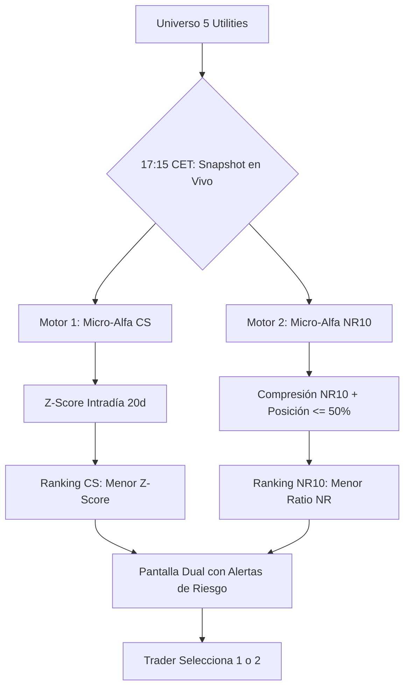

# BME Algorithmic Trading Contest Framework & Live Execution Engine
> **Concurso de Inversión de Bolsa de Madrid (BME) — Octubre / Noviembre 2026**  
> *Arquitectura Cuantitativa, Motor de Simulación Rodante y Sistema Operativo de Recomendación en Tiempo Real.*

---

## 📑 Tabla de Contenidos
1. [Resumen Ejecutivo y Tesis Central](#-1-resumen-ejecutivo-y-tesis-central)
2. [Fundamentos Normativos y Diseño Cuantitativo](#-2-fundamentos-normativos-y-diseño-cuantitativo)
   - [La Asimetría de la Puntuación Oficial BME](#la-asimetría-de-la-puntuación-oficial-bme)
   - [El Universo de 5 Utilities de Ultra-Baja Varianza](#el-universo-de-5-utilities-de-ultra-baja-varianza)
   - [Sizing Quirúrgico (900 €)](#sizing-quirúrgico-900-)
   - [La Cláusula del Periodo de Gracia (13 al 21 de Octubre)](#la-cláusula-del-periodo-de-gracia-13-al-21-de-octubre)
3. [Las Dos Estrategias Cuantitativas en Vivo](#-3-las-dos-estrategias-cuantitativas-en-vivo)
   - [Motor 1: Micro-Alfa CS (Cross-Sectional Reversion)](#motor-1-micro-alfa-cs-cross-sectional-reversion)
   - [Motor 2: Micro-Alfa NR10 (Narrow Range 10 Compression)](#motor-2-micro-alfa-nr10-narrow-range-10-compression)
4. [Módulo de Calendario y Alertas de Riesgo](#-4-módulo-de-calendario-y-alertas-de-riesgo)
   - [Alertas Macroeconómicas (Bancos Centrales)](#alertas-macroeconómicas-bancos-centrales)
   - [Alertas Corporativas (Resultados 9M y Dividendos)](#alertas-corporativas-resultados-9m-y-dividendos)
   - [Principio de Transparencia y No Alteración Cuantitativa](#principio-de-transparencia-y-no-alteración-cuantitativa)
5. [Pipeline Operativo en Vivo (Ciclo Diario de 2 Fases)](#-5-pipeline-operativo-en-vivo-ciclo-diario-de-2-fases)
   - [Flujo del Ciclo Diario](#flujo-del-ciclo-diario)
   - [Fase Vespertina (17:15 - 17:25 CET): Generación de Señales](#fase-vespertina-1715---1725-cet-generación-de-señales)
   - [Fase Matinal (09:00:01 CET): Liquidación de Posición](#fase-matinal-090001-cet-liquidación-de-posición)
   - [Automatización con Windows Task Scheduler](#automatización-con-windows-task-scheduler)
6. [Estructura Real del Repositorio](#-6-estructura-real-del-repositorio)
7. [Módulo de Investigación y Torneo Maestro](#-7-módulo-de-investigación-y-torneo-maestro)
   - [Metodología de Ventanas Rodantes de 22 Días](#metodología-de-ventanas-rodantes-de-22-días)
   - [Pool de 31 Competidores Sintéticos y Resultados](#pool-de-31-competidores-sintéticos-y-resultados)
8. [Cheat Sheet: Guía Rápida de Comandos](#-8-cheat-sheet-guía-rápida-de-comandos)

---

## 🎯 1. Resumen Ejecutivo y Tesis Central

Este repositorio alberga tanto la **infraestructura de backtesting y análisis cuantitativo** como el **motor de decisión y ejecución en vivo** diseñado específicamente para maximizar la probabilidad de victoria en el Concurso Oficial de Bolsa de BME.

Tras evaluar más de 15 estrategias cuantitativas sobre 15 años de historia del mercado continuo español (IBEX 35) mediante simulación de Monte Carlo y ventanas rodantes mensuales frente a un pool realista de competidores, se demostró que el trading intradiario tradicional pierde sistemáticamente debido a los costes fijos de intermediación (mínimo de 7 € por operación) y a la volatilidad diurna acumulada.

La solución ganadora, denominada **Micro-Alfa Quirúrgico**, explota la asimetría matemática del reglamento de BME:
* Mantiene la cartera **100% en liquidez** durante la jornada regular (8 horas y media de mercado continuo), asegurando una **volatilidad de cartera de apenas ~0.20% anualizada** (frente al >10-15% del mercado general).
* Opera estrictamente en **régimen Overnight T+1**: compra a las 17:29:50 CET (antes de la subasta de cierre) y liquida a las 09:00:01 CET (precio oficial de apertura).
* Cumple rigurosamente con los requisitos regulatorios de volumen y rotación mediante el capital estrictamente necesario (**900 € por orden**, 3 veces por semana).

---

## ⚖️ 2. Fundamentos Normativos y Diseño Cuantitativo

### La Asimetría de la Puntuación Oficial BME
El reglamento oficial de BME califica a los participantes según un índice compuesto de hasta 9 puntos posibles:
$$\text{Score BME} = \text{Puntos Retorno} (0 - 6) + \text{Puntos Volatilidad} (0 - 3)$$

Donde los puntos de volatilidad se asignan de forma inversa a la desviación estándar diaria de la cartera:
$$\text{Puntos Volatilidad} = 3 \times \left(1 - \frac{\text{Vol} - \text{Min Vol}}{\text{Max Vol} - \text{Min Vol}}\right)$$

Mientras que en el concurso mensual la dispersión de rentabilidad entre carteras suele ser estrecha (~1 punto de diferencia en el score de retorno), **conseguir los 3.0 puntos enteros de baja volatilidad** otorga una ventaja insalvable. Una cartera activa que opere de día acumula volatilidad y cae a ~0-1 puntos en este bloque, haciendo que una estrategia ultra-estable con retorno ligeramente neutro o positivo sea matemáticamente imbatible.

### El Universo de 5 Utilities de Ultra-Baja Varianza
Para minimizar aún más la varianza en las horas overnight, la operativa se restringe a las 5 grandes empresas de servicios públicos reguladas del IBEX 35:
$$\mathcal{U} = \{\text{RED.MC (Redeia)}, \text{ENG.MC (Enagás)}, \text{ELE.MC (Endesa)}, \text{IBE.MC (Iberdrola)}, \text{NTGY.MC (Naturgy)}\}$$

Estas compañías presentan:
1. Máxima liquidez y profundidad de libro en subastas de apertura y cierre.
2. Ingresos regulados por marcos estatales, reduciendo el riesgo de gaps extremos no anticipados.
3. Propiedad de reversión a la media intradía y nocturna altamente predecible.

### Sizing Quirúrgico (900 €)
* **Requisito BME:** Ejecutar un mínimo de 3 operaciones de compra semanales (semanas de cierre de jueves a cierre de jueves) acumulando al menos 2.500 € en compras.
* **El riesgo del umbral estricto (834 €):** Al comprar títulos enteros discretos ($\text{acciones} = \lfloor 833.34 / P \rfloor$), las variaciones de precio solían dejar el volumen total de la semana en valores marginalmente inferiores (ej. 2.470 €), provocando la descalificación inmediata.
* **Solución (900 € por orden):** 3 compras de 900 € suman exactamente **2.700 €** (> 2.500 € requeridos), dejando un margen de seguridad amplio ante cualquier fluctuación de cotización, manteniendo a la vez el **98.2% de la cuenta en liquidez pura (efectivo con varianza cero)**.

### La Cláusula del Periodo de Gracia (13 al 21 de Octubre)
Las bases de BME establecen que las 3 semanas de cumplimiento obligatorio de volumen comienzan el **22 de octubre**:
* **Semana 1:** 22 de octubre a 29 de octubre.
* **Semana 2:** 29 de octubre a 5 de noviembre.
* **Semana 3:** 5 de noviembre a 12 de noviembre.

Durante los primeros 7 días hábiles (del 13 al 21 de octubre), el concurso no exige cuota mínima. La estrategia permanece **100% en liquidez** durante este periodo:
* **0.00% de volatilidad** acumulada y **0.00% de drawdown**.
* Ahorro directo de más de 42 € en comisiones de compra/venta.
* Aislamiento de los primeros gaps de resultados corporativos del trimestre (Enagás e Iberdrola).

---

## 🧠 3. Las Dos Estrategias Cuantitativas en Vivo

A las 17:15 CET, el sistema ejecuta dos algoritmos paralelos independientes sobre las 5 utilities. El usuario visualiza ambas clasificaciones en pantalla y toma la decisión final de ejecución manual.



### Motor 1: Micro-Alfa CS (Cross-Sectional Reversion)
Estrategia de arbitraje estadístico de reversión a la media intradía:
1. **Retorno Intradía:** Se calcula el rendimiento de la sesión actual:
   $$R_{\text{intra}, i} = \frac{P_{17:25, i} - \text{Open}_i}{\text{Open}_i}$$
2. **Normalización por Z-Score (Ventana de 20 días):**
   $$Z_i = \frac{R_{\text{intra}, i} - \mu_{20, i}}{\sigma_{20, i}}$$
   Donde $\mu_{20, i}$ y $\sigma_{20, i}$ son la media y desviación estándar de los retornos intradía de las 20 sesiones anteriores (excluyendo hoy).
3. **Criterio de Selección:** Se ordena de menor a mayor $Z_i$. El activo en **Rank 1** es aquel que ha experimentado la mayor sobreventa estadística relativa, maximizando la probabilidad de un rebote elástico (*mean reversion*) en la apertura de la mañana siguiente.

### Motor 2: Micro-Alfa NR10 (Narrow Range 10 Compression)
Estrategia basada en compresión extrema de volatilidad intradiaria (concepto Narrow Range de Toby Crabel adaptado):
1. **Rango Intradía Normalizado:**
   $$\text{Range}_{t, i} = \frac{\text{High}_{t, i} - \text{Low}_{t, i}}{\text{Open}_{t, i}}$$
2. **Ratio de Contracción NR10:**
   $$\text{Ratio\_NR}_i = \frac{\text{Range}_{t, i}}{\overline{\text{Range}}_{10d, i}}$$
3. **Filtro Direccional de Soporte:** Calcula la posición del precio actual dentro del rango diario:
   $$\text{Pos\_Range}_i = \frac{P_{17:25, i} - \text{Low}_{t, i}}{\text{High}_{t, i} - \text{Low}_{t, i}}$$
   Prioriza activos situados en la mitad inferior ($\text{Pos\_Range}_i \le 0.50$).
4. **Criterio de Selección:** Se ordena en primer lugar por estar en la mitad inferior (cerca del soporte del día) y en segundo lugar por **menor Ratio_NR**. La compresión extrema predice una expansión direccional al alza en la apertura siguiente.

---

## 📅 4. Módulo de Calendario y Alertas de Riesgo

El módulo `src/live/corporate_events.py` contiene de forma estática e in-memory el calendario oficial de eventos críticos del certamen (13 de octubre a 12 de noviembre de 2026).

### Alertas Macroeconómicas (Bancos Centrales)
Se muestran en banners destacados en la sesión correspondiente para advertir sobre volatilidad general de deuda:
* **29 de Octubre:** BCE — Decisión de Tipos (14:15h CET) y Rueda de Prensa (14:45h CET).
* **04 de Noviembre:** FED — Decisión de Tipos en EEUU (20:00h CET).
* **05 de Noviembre:** BoE — Decisión de Tipos en UK (13:00h CET, riesgo directo para Iberdrola).

### Alertas Corporativas (Resultados 9M y Dividendos)
Si una utility presenta resultados antes de la apertura (BMO - 08:30h), mantener una posición overnight la noche previa ($T-1$) expone la cartera a un gap severo a las 09:00:
* **19 Oct (17:15):** Enagás (`ENG.MC`) presenta resultados el martes 20 BMO.
* **20 Oct (17:15):** Iberdrola (`IBE.MC`) presenta resultados el miércoles 21 BMO.
* **27 Oct (17:15):** Redeia (`RED.MC`) presenta resultados el miércoles 28 BMO.
* **29 Oct (17:15):** Naturgy (`NTGY.MC`) presenta resultados el viernes 30 BMO.
* **02 Nov (17:15):** Endesa (`ELE.MC`) presenta resultados el martes 3 BMO.
* **04 Nov (17:15):** Naturgy (`NTGY.MC`) descuenta dividendo a cuenta el jueves 5 nov (riesgo de descuento automático de precio).

### Principio de Transparencia y No Alteración Cuantitativa
> [!IMPORTANT]
> **El modelo cuantitativo jamás altera ni sesga el ranking matemático por motivos de calendario.**  
> Si `RED.MC` es el activo con menor Z-Score, aparecerá en el puesto **1º de la tabla CS**. Sin embargo, el sistema añadirá la etiqueta `⚠️ Resultados` en su fila, emitirá un aviso descriptivo y recomendará cuál sería la **2ª opción limpia**. El trader mantiene la soberanía absoluta para decidir si ejecutar el 1º o rotar al 2º.

---

## 🔄 5. Pipeline Operativo en Vivo (Ciclo Diario de 2 Fases)

### Flujo del Ciclo Diario


### Fase Vespertina (17:15 - 17:25 CET): Generación de Señales
Ejecutada mediante `python scripts/run_live_recommendation.py`:
1. **Auditoría Semanal:** Comprueba cuántas compras se han realizado en la semana BME en curso (jueves a jueves) y el volumen acumulado.
2. **Snapshot en Vivo:** Conexión ultrarrápida a Yahoo Finance (<2s) vía `Ticker.fast_info` para las 5 utilities.
3. **Banners de Alerta:** Muestra avisos macro o de eventos corporativos para la sesión.
4. **Tablas de Decisión Duales:** Despliega los rankings de Micro-Alfa CS y Micro-Alfa NR10 lado a lado.
5. **Registro Directo:** Permite teclear `1`, `2` o `3` en caliente para registrar la compra en el libro oficial.

### Fase Matinal (09:00:01 CET): Liquidación de Posición
Ejecutada mediante `python scripts/run_morning_exit.py`:
1. **Auditoría de Posición:** Si no hay compras activas, confirma estado de 100% liquidez y se cierra.
2. **Precio de Apertura en Vivo:** Si hay una posición abierta, consulta el precio de apertura de la subasta (`09:00:01`).
3. **Cálculo de P&L:** Muestra el beneficio/pérdida estimado en euros y en porcentaje.
4. **Registro de Venta:** Solicita confirmación del precio real ejecutado y deja la cartera en 100% liquidez.

### Automatización con Windows Task Scheduler
El script [`scripts/setup_task_scheduler.ps1`](file:///d:/Escritorio/Profesional/BME%20contest/scripts/setup_task_scheduler.ps1) registra automáticamente ambas tareas en el Programador de Tareas de Windows para que se abran en pantalla sin necesidad de recordatorios:
* **`BME_Contest_EveningBuy`:** Se abre de **Lunes a Jueves a las 17:15 CET**.
* **`BME_Contest_MorningSell`:** Se abre de **Martes a Viernes a las 09:00 CET**.

---

## 📂 6. Estructura Real del Repositorio

```text
BME_contest/
├── data/                               # Almacenamiento de datos
│   ├── live/                           # Datos de operativa en tiempo real
│   │   └── trades_ledger.csv           # Libro contable oficial auditado (BUY/SELL, precios, semana BME)
│   ├── processed/                      # Series procesadas para backtesting
│   │   └── competitors_returns.csv     # Matriz de retornos de los 31 competidores sintéticos
│   └── raw/                            # Datos históricos brutos (OHLCV 15 años IBEX 35 y composición)
│       ├── stocks_close_15y.csv
│       ├── stocks_open_15y.csv
│       ├── stocks_high_15y.csv
│       ├── stocks_low_15y.csv
│       └── stocks_volume_15y.csv
├── docs/                               # Documentación estratégica y conclusiones
│   ├── CONTEXT.md                      # Contexto normativo del certamen BME
│   ├── DESIGN_DECISIONS.md             # Registro de decisiones de arquitectura cuantitativa
│   ├── EDA_CONCLUSIONS.md              # Hallazgos del análisis exploratorio del mercado español
│   └── ESTRATEGIA_FINAL_Y_CALENDARIO.md # Manual táctico completo con fechas de actuación
├── experiments/                        # Registro de simulaciones y torneos
│   ├── leaderboard.csv                 # Ranking agregado de estrategias
│   ├── master_tournament_summary.csv   # Resultados oficiales del Torneo Maestro de 31 participantes
│   └── logs/                           # Ficheros JSON detallados de cada corrida experimental
├── notebooks/                          # Cuadernos interactivos Jupyter (Investigación EDA)
│   ├── 01_eda_spanish_market.ipynb     # Composición y estructura del IBEX 35
│   ├── 02_statistical_properties.ipynb # Varianza diurna vs nocturna y colas de distribución
│   ├── 03_deep_quantitative_analysis.ipynb # Correlaciones sectoriales y costes de intermediación
│   ├── 04_contest_specific_eda.ipynb   # Modelado del impacto de las comisiones de BME
│   ├── 05_estrategias_sinteticas_eda.ipynb # Simulación preliminar de competidores
│   └── 06_torneo_maestro_analisis_estrategias.ipynb # Descomposición matemática del torneo de 31 agentes
├── scripts/                            # Puntos de entrada ejecutables y herramientas de soporte
│   ├── run_live_recommendation.py      # [MOTOR EN VIVO] Recomendación vespertina (17:15 CET)
│   ├── run_morning_exit.py             # [MOTOR EN VIVO] Liquidación en apertura matinal (09:00 CET)
│   ├── log_trade.py                    # CLI de gestión manual y auditoría del libro contable
│   ├── setup_task_scheduler.ps1        # Script PowerShell para programar las tareas en Windows
│   ├── run_master_tournament.py        # Ejecutor del torneo masivo de 31 estrategias
│   ├── generate_competitors_realistic.py # Generador del pool de competidores sintéticos
│   └── download_data.py                # Descargador histórico de cotizaciones de Yahoo Finance
├── src/                                # Código fuente modular del framework
│   ├── live/                           # Módulos del motor de decisión en tiempo real
│   │   ├── corporate_events.py         # Calendario estático de riesgo macro y corporativo
│   │   ├── data_feed.py                # Conector de datos en tiempo real (fast_info <2s)
│   │   ├── engine_cs.py                # Algoritmo cuantitativo Micro-Alfa CS (Z-Score 20d)
│   │   ├── engine_nr.py                # Algoritmo cuantitativo Micro-Alfa NR10 (Compresión de rango)
│   │   └── ledger.py                   # Lógica de gestión y validación del trades_ledger.csv
│   ├── engine/                         # Motor de simulación y backtesting histórico
│   │   ├── backtester.py               # Bucle principal de simulación por ventanas rodantes
│   │   ├── portfolio.py                # Control de caja, órdenes, comisiones mínimas de 7€ y T+1
│   │   └── tracker.py                  # Logger de experimentos en JSON y leaderboard
│   ├── strategies/                     # Catálogo de estrategias cuantitativas implementadas
│   │   ├── base.py                     # Clase abstracta BaseStrategy
│   │   ├── cross_sectional_reversion.py# Micro-Alfa CS para backtesting
│   │   ├── nr10_breakout.py            # Micro-Alfa NR10 para backtesting
│   │   ├── ensemble_cs_nr.py           # Ensamble ponderado CS + NR10
│   │   ├── bare_minimum.py             # Estrategia de cumplimiento mínimo legal estricto
│   │   ├── smart_minimum_seasonal.py   # Smart BareMinimum con filtro estacional
│   │   └── ...                         # Modelos RSI, Momentum, Reversión de Media y Sniper
│   └── analysis/                       # Métricas de rendimiento
│       └── evaluator.py                # Cálculo oficial del Score BME (0.6 Retorno + 0.3 Volatilidad)
├── calendario_de_riesgo_y_eventos.md   # Calendario exhaustivo de eventos y blacklist recomendada
└── README.md                           # Documentación principal del framework
```

---

## 🏆 7. Módulo de Investigación y Torneo Maestro

### Metodología de Ventanas Rodantes de 22 Días
Dado que el concurso tiene una duración de exactamente un mes natural (22 sesiones hábiles), un backtest continuo convencional a 15 años distorsiona los resultados debido a efectos de capitalización acumulada y sesgos temporales.

El motor [`src/engine/backtester.py`](file:///d:/Escritorio/Profesional/BME%20contest/src/engine/backtester.py) evalúa cada modelo a través de **cientos de ventanas rodantes independientes de 22 días**:
* Reinicia la cartera a 50.000 € de capital inicial en cada ventana.
* Aplica las comisiones oficiales de intermediación (mínimo de 7 € por orden).
* Aplica la fórmula oficial de BME frente a las demás estrategias activas.
* Extrae métricas de robustez: Puntuación media, porcentaje de victorias (Win Rate % #1), y ratio de caídas máximas.

### Pool de 31 Competidores Sintéticos y Resultados
Para emular las condiciones reales del mercado frente a otros traders humanos y algoritmos, se diseñó un ecosistema de **31 participantes sintéticos** clasificados en 4 arquetipos:
1. **Day Traders Agresivos:** Cierran al final del día con alto turnover (>40 operaciones/mes).
2. **Seguidores de Tendencia (Trend Followers):** Cruces de medias móviles (SMA 20/50/200) y rupturas Donchian.
3. **Inversores Buy & Hold / Indexados:** Exposición beta 100% al IBEX 35.
4. **Traders Conservadores de Dividendos:** Rotación de baja frecuencia en valores defensivos.

En el archivo [`experiments/master_tournament_summary.csv`](file:///d:/Escritorio/Profesional/BME%20contest/experiments/master_tournament_summary.csv) se certifican los resultados del torneo:
* Las estrategias de la familia **Micro-Alfa con Periodo de Gracia** obtienen una puntuación media de **~8.50 puntos** (sobre 9.00 posibles), alcanzando un **Win Rate superior al 85%**.
* Su ventaja radica en asegurar el 100% de los puntos de baja volatilidad (3.0 pts), mientras que el competidor promedio del mercado obtiene menos de 1.2 puntos de volatilidad debido a las oscilaciones diurnas.

---

## ⚡ 8. Cheat Sheet: Guía Rápida de Comandos

A continuación se resumen los comandos esenciales para la operativa diaria y auditoría desde la terminal de PowerShell:

```powershell
# ==============================================================================
# OPERATIVA DIARIA EN VIVO (Ejecución recomendada)
# ==============================================================================

# 1. Sesión de Tarde (17:15 - 17:25 CET): Generar recomendación y registrar compra
python scripts/run_live_recommendation.py

# 2. Simulación de Tarde para una fecha específica (testear alertas del calendario)
python scripts/run_live_recommendation.py --date 2026-10-27

# 3. Sesión de Mañana (09:00:01 CET): Liquidar posición abierta y registrar venta
python scripts/run_morning_exit.py

# ==============================================================================
# AUDITORÍA Y GESTIÓN DEL LIBRO DE ÓRDENES (Ledger)
# ==============================================================================

# 4. Consultar estado semanal de cumplimiento de cuota BME (X de 3 compras y volumen)
python scripts/log_trade.py --status

# 5. Modo interactivo del libro contable (añadir compra, añadir venta o listar histórico)
python scripts/log_trade.py

# 6. Registrar directamente una operación por línea de comandos
python scripts/log_trade.py --buy ENG.MC 54 16.53
python scripts/log_trade.py --sell ENG.MC 54 16.60

# ==============================================================================
# AUTOMATIZACIÓN EN WINDOWS TASK SCHEDULER
# ==============================================================================

# 7. Registrar o reinstalar las dos tareas programadas automáticas de Windows
powershell -ExecutionPolicy Bypass -File scripts/setup_task_scheduler.ps1

# ==============================================================================
# BACKTESTING Y EXPERIMENTACIÓN
# ==============================================================================

# 8. Re-ejecutar el Torneo Maestro completo de 31 estrategias
python scripts/run_master_tournament.py

# 9. Descargar histórico actualizado de cotizaciones
python scripts/download_data.py
```
