# Algorithmic Strategies Catalog & Technical Reference

> **Module:** `src/strategies/`  
> **Scope:** In-depth algorithmic specifications, mathematical formulations, indicators, and comparative empirical performance for every strategy developed in the framework.  
> *(For tournament regulatory rules, scoring formulas, and live production operational cycles, refer directly to the root [README.md](file:///d:/Escritorio/Profesional/BME%20contest/README.md)).*

---

## 📑 Table of Contents

1. [Strategy Taxonomy & Architecture](#1-strategy-taxonomy--architecture)
2. [The Base Contract: `BaseStrategy` (`base.py`)](#2-the-base-contract-basestrategy-basepy)
3. [Exhaustive Strategy Catalog (All 21 Implemented Models)](#3-exhaustive-strategy-catalog-all-21-implemented-models)
   - [Family A: Minimum Exposure & Regulatory Chassis](#family-a-minimum-exposure--regulatory-chassis)
     - [1. `BareMinimumStrategy` (`bare_minimum.py`)](#1-bareminimumstrategy-bare_minimumpy)
     - [2. `SmartMinimumSeasonal` (`smart_minimum_seasonal.py`)](#2-smartminimumseasonal-smart_minimum_seasonalpy)
     - [3. `SmartMinimumContrarian` (`smart_minimum_contrarian.py`)](#3-smartminimumcontrarian-smart_minimum_contrarianpy)
     - [4. `SmartMinimumIntraday` (`smart_minimum_intraday.py`)](#4-smartminimumintraday-smart_minimum_intradaypy)
   - [Family B: Surgical Micro-Alpha & Ensembles (€900 Sizing)](#family-b-surgical-micro-alpha--ensembles-900-sizing)
     - [5. `MicroAlfaQuirurgico` — CS Engine (`micro_alfa_quirurgico.py`)](#5-microalfaquirurgico--cs-engine-micro_alfa_quirurgicopy)
     - [6. `MicroAlfaQuirurgico` — NR10 Engine (`micro_alfa_quirurgico.py`)](#6-microalfaquirurgico--nr10-engine-micro_alfa_quirurgicopy)
     - [7. `EnsembleCSNR` (`ensemble_cs_nr.py`)](#7-ensemblecsnr-ensemble_cs_nrpy)
   - [Family C: Fee-Diluted Quantitative Engines (€4,667 Sizing)](#family-c-fee-diluted-quantitative-engines-4667-sizing)
     - [8. `CrossSectionalReversion` (`cross_sectional_reversion.py`)](#8-crosssectionalreversion-cross_sectional_reversionpy)
     - [9. `NR10Breakout` (`nr10_breakout.py`)](#9-nr10breakout-nr10_breakoutpy)
     - [10. `ContinuousUtilityReversion` (`continuous_utility_reversion.py`)](#10-continuousutilityreversion-continuous_utility_reversionpy)
   - [Family D: Multi-Asset Swing & Classical Technical Models](#family-d-multi-asset-swing--classical-technical-models)
     - [11. `SlowTrainStrategy` (`slow_train.py`)](#11-slowtrainstrategy-slow_trainpy)
     - [12. `PatientSniperStrategy` (`patient_sniper.py`)](#12-patientsniperstrategy-patient_sniperpy)
     - [13. `ConservativeBlueChipRotation` (`conservative_rotation.py`)](#13-conservativebluechiprotation-conservative_rotationpy)
     - [14. `BaselineReversion` (`baseline_reversion.py`)](#14-baselinereversion-baseline_reversionpy)
     - [15. `OvernightQualityReversion` (`quality_reversion.py`)](#15-overnightqualityreversion-quality_reversionpy)
     - [16. `RsiOvernightReversion` (`rsi_reversion.py`)](#16-rsiovernightreversion-rsi_reversionpy)
     - [17. `SingleAssetMaster` (`single_asset.py`)](#17-singleassetmaster-single_assetpy)
     - [18. `MeanReversionStrategy` (`mean_reversion.py`)](#18-meanreversionstrategy-mean_reversionpy)
     - [19. `SeasonalitySafeHaven` (`seasonality_safehaven.py`)](#19-seasonalitysafehaven-seasonality_safehavenpy)
     - [20. `TurnaroundTuesday` (`turnaround_tuesday.py`)](#20-turnaroundtuesday-turnaround_tuesdaypy)
     - [21. `UltraLowVolMomentum` (`ultralowvol_momentum.py`)](#21-ultralowvolmomentum-ultralowvol_momentumpy)
4. [Master Tournament Results Across Strategies (Sorted by Win Rate)](#4-master-tournament-results-across-strategies-sorted-by-win-rate)

---

## 1. Strategy Taxonomy & Architecture

All strategies are designed under the **Overnight T+1 Execution Framework**: signals are evaluated in the afternoon (17:15–17:29:50 CET), orders enter before market close, and positions are fully liquidated at the opening auction (09:00:01 CET) the next morning.

The 21 models fall into four architectural families based on universe, sizing, and decision mechanisms:

```mermaid
flowchart TD
    Base[BaseStrategy] --> FamA[Family A: Minimum Exposure Chassis\nSingle-Asset RED.MC, Weekly Risk Management]
    Base --> FamB[Family B: Surgical Micro-Alpha €900\n5 Regulated Utilities, Cross-Ranking Ensembles]
    Base --> FamC[Family C: Anti-Fee Engines €4,667\nThreshold Mean Reversion, Range Compression]
    Base --> FamD[Family D: Multi-Asset Swing Models\nIBEX 35 Broad Universe, Momentum & RSI Filters]

    FamA --> S1[BareMinimum]
    FamA --> S2[SmartMin_Seasonal]
    FamA --> S3[SmartMin_Contrarian]
    FamA --> S4[SmartMin_Intraday]

    FamB --> S5[MicroAlfa_CS]
    FamB --> S6[MicroAlfa_NR10]
    FamB --> S7[Ensemble_CS_NR]

    FamC --> S8[CS_MeanReversion]
    FamC --> S9[NR10_Breakout]
    FamC --> S10[BareMinimum_Alpha]

    FamD --> S11[Slow_Train]
    FamD --> S12[Patient_Sniper]
    FamD --> S13[Conservative_BC_Rotation]
    FamD --> S14[Fade the Winner]
    FamD --> S15[Quality_Reversion_200]
    FamD --> S16[RSI_Overnight_3d]
    FamD --> S17[SingleAsset_IBE]
    FamD --> S18[MeanReversion_Surv]
    FamD --> S19[Seasonality_SafeHaven]
    FamD --> S20[Turnaround_Tuesday]
    FamD --> S21[UltraLowVol_Momentum]
```



---

## 2. The Base Contract: `BaseStrategy` (`base.py`)

All models inherit from [`BaseStrategy`](file:///d:/Escritorio/Profesional/BME%20contest/src/strategies/base.py), guaranteeing uniform interoperability with the backtesting engine, optimization grids, and live execution pipelines:

* **Location:** [`src/strategies/base.py`](file:///d:/Escritorio/Profesional/BME%20contest/src/strategies/base.py)
* **Core Contract:**
  ```python
  from abc import ABC, abstractmethod

  class BaseStrategy(ABC):
      def __init__(self, name="BaseStrategy", **kwargs):
          self.name = name
          self.params = kwargs

      @abstractmethod
      def generate_signals(self, current_date, market_data, portfolio):
          """
          Core signal generator invoked each session.
          
          :param current_date: Timestamp of current simulation session.
          :param market_data: Dict with historical OHLCV DataFrames indexed by date.
          :param portfolio: Portfolio instance tracking cash, open positions, and history.
          :return: List of order dicts (e.g., [{'ticker': 'RED.MC', 'action': 'buy', 'amount_eur': 900.0}]
                   or [{'ticker': 'RED.MC', 'action': 'sell', 'price_type': 'open'}]).
          """
          pass

      def get_metadata(self):
          return {'strategy_class': self.__class__.__name__, 'params': self.params}
  ```

---

## 3. Exhaustive Strategy Catalog (All 21 Implemented Models)

---

### Family A: Minimum Exposure & Regulatory Chassis

#### 1. `BareMinimumStrategy` (`bare_minimum.py`)
* **Class:** `BareMinimumStrategy` | **Instance Name:** `BareMinimum`
* **Source:** [`src/strategies/bare_minimum.py`](file:///d:/Escritorio/Profesional/BME%20contest/src/strategies/bare_minimum.py)
* **Underlying Asset:** `RED.MC` (Redeia Corporación / Red Eléctrica)
* **Trading Frequency:** 5 nights per week (Monday through Friday)
* **Order Sizing:** €1,200 per buy order (~€6,000 weekly volume)
* **Hypothesis:** Holding only the lowest-variance regulated asset in Spain overnight and remaining in 100% cash during trading hours drives portfolio standard deviation down to the absolute mathematical minimum.
* **Logic:**
  1. *Open Liquidation:* Liquidates any open position of `RED.MC` held $\ge 1$ day at 09:00:01 open.
  2. *Close Buy:* Unconditionally emits a buy order for €1,200 of `RED.MC` at 17:29:50.
* **Empirical Behavior:** Achieves the lowest gross annualized volatility in historical simulations (0.19%). However, running 10 trades weekly generates €70/week in broker fees, producing a cumulative 1-month return of -0.59%. Friday night positions also expose the portfolio to weekend gap risk without improving competition scoring.

#### 2. `SmartMinimumSeasonal` (`smart_minimum_seasonal.py`)
* **Class:** `SmartMinimumSeasonal` | **Instance Name:** `SmartMin_Seasonal`
* **Source:** [`src/strategies/smart_minimum_seasonal.py`](file:///d:/Escritorio/Profesional/BME%20contest/src/strategies/smart_minimum_seasonal.py)
* **Underlying Asset:** `RED.MC`
* **Trading Frequency:** Exactly 3 nights per week (Monday, Tuesday, Wednesday close)
* **Order Sizing:** €2,500 per order (€7,500 weekly volume)
* **Hypothesis:** Temporal risk reduction. BME evaluates weeks from Thursday close to Thursday close. Buying Monday, Tuesday, and Wednesday close (liquidated Tuesday, Wednesday, and Thursday open) completes all 3 required trades inside the qualification window while completely eliminating Thursday and Friday night exposure (zero weekend risk).
* **Logic:**
  ```python
  day_of_week = pd.Timestamp(current_date).weekday() # 0=Mon, 1=Tue, 2=Wed
  if day_of_week in [0, 1, 2]:
      orders.append({'ticker': 'RED.MC', 'action': 'buy', 'amount_eur': 2500})
  ```
* **Empirical Behavior:** Champion of Phase 4 (35.88% win rate). Avoiding Monday open gaps (from weekend events) improved net 1-month return from -0.59% to -0.36%, maintaining an ultra-low annualized volatility of 0.35%.

#### 3. `SmartMinimumContrarian` (`smart_minimum_contrarian.py`)
* **Class:** `SmartMinimumContrarian` | **Instance Name:** `SmartMin_Contrarian`
* **Source:** [`src/strategies/smart_minimum_contrarian.py`](file:///d:/Escritorio/Profesional/BME%20contest/src/strategies/smart_minimum_contrarian.py)
* **Underlying Asset:** `RED.MC`
* **Trading Frequency:** Up to 3 nights per week (Mon–Wed conditional, Thu–Fri fallback)
* **Order Sizing:** €2,500 per order
* **Hypothesis:** Regulated utilities exhibit strong intraday mean reversion. Entering long only after a down session captures an elastic rebound during the morning open auction.
* **Logic:**
  1. Evaluates session displacement: `is_red_day = (Close < Open)`.
  2. On Monday, Tuesday, or Wednesday, buys only if `is_red_day == True`.
  3. On Thursday and Friday, forces execution if fewer trades have occurred, guaranteeing compliance.
* **Empirical Behavior:** Win rate of 21.10% in Phase 4. Narrows 1-month loss to -0.39% with 0.34% annualized volatility.

#### 4. `SmartMinimumIntraday` (`smart_minimum_intraday.py`)
* **Class:** `SmartMinimumIntraday` | **Instance Name:** `SmartMin_Intraday`
* **Source:** [`src/strategies/smart_minimum_intraday.py`](file:///d:/Escritorio/Profesional/BME%20contest/src/strategies/smart_minimum_intraday.py)
* **Underlying Asset:** `RED.MC`
* **Trading Frequency:** Up to 3 nights per week
* **Order Sizing:** €2,500 per order
* **Hypothesis:** Volatility persistence filter. Calm daytime sessions predict tranquil overnight auctions, while volatile daytime sessions signal corporate news, earnings, or macroeconomic repricing.
* **Mathematical Formulation:**
  $$\text{Disp}_t = \left| \frac{\text{Close}_t}{\text{Open}_t} - 1 \right|, \quad \mu_{\text{Disp}, 10} = \frac{1}{10} \sum_{k=0}^9 \text{Disp}_{t-k}$$
  $$\text{Trigger} = (\text{Disp}_t < \mu_{\text{Disp}, 10}) \quad \text{for Monday to Wednesday}$$
* **Empirical Behavior:** Filters turbulent sessions effectively, recording 0.34% annualized volatility and -0.42% 1-month return.

---

### Family B: Surgical Micro-Alpha & Ensembles (€900 Sizing)

#### 5. `MicroAlfaQuirurgico` — CS Engine (`micro_alfa_quirurgico.py`)
* **Class:** `MicroAlfaQuirurgico(engine='cs_reversion')` | **Instance Name:** `MicroAlfa_CS`
* **Source:** [`src/strategies/micro_alfa_quirurgico.py`](file:///d:/Escritorio/Profesional/BME%20contest/src/strategies/micro_alfa_quirurgico.py)
* **Universe:** 5 Regulated Utilities (`RED.MC`, `ENG.MC`, `ELE.MC`, `IBE.MC`, `NTGY.MC`)
* **Trading Frequency:** Monday, Tuesday, Wednesday at 17:29:50 CET
* **Order Sizing:** €900 per order (€2,700 weekly volume)
* **Hypothesis:** Rotates capital strictly to the utility experiencing the greatest intraday dislocation relative to its historical distribution. Sizing at €900 satisfies the regulatory €2,500 weekly minimum with a cushion (€2,700), while keeping 98.2% of the portfolio in zero-risk cash.
* **Mathematical Formulation:**
  $$R_{\text{intra}, t, i} = \frac{\text{Close}_{t, i} - \text{Open}_{t, i}}{\text{Open}_{t, i}}$$
  $$Z_{t, i} = \frac{R_{\text{intra}, t, i} - \mu_{20}(R_{\text{intra}, i})}{\sigma_{20}(R_{\text{intra}, i})}$$
  $$\text{Selected Asset} = \operatorname{argmin}_{i \in \mathcal{U}} (Z_{t, i})$$
* **Empirical Behavior:** Annualized volatility collapses to **0.20% - 0.21%**. High gross win rate (31.3% absolute #1 finishes in Phase 6). With Grace Period support, achieves an average tournament score of **8.4962 points**.

#### 6. `MicroAlfaQuirurgico` — NR10 Engine (`micro_alfa_quirurgico.py`)
* **Class:** `MicroAlfaQuirurgico(engine='nr10')` | **Instance Name:** `MicroAlfa_NR10`
* **Source:** [`src/strategies/micro_alfa_quirurgico.py`](file:///d:/Escritorio/Profesional/BME%20contest/src/strategies/micro_alfa_quirurgico.py)
* **Universe:** 5 Regulated Utilities
* **Trading Frequency:** Monday, Tuesday, Wednesday at 17:29:50 CET
* **Order Sizing:** €900 per order
* **Hypothesis:** Extreme range contraction (Toby Crabel's Narrow Range principle) on regulated utilities forecasts an expansive directional rebound at next morning's open, particularly when the price has consolidated in the lower half of the session range.
* **Mathematical Formulation:**
  1. *Normalized Range:* $\text{Range}_{t, i} = \frac{\text{High}_{t, i} - \text{Low}_{t, i}}{\text{Open}_{t, i}}$
  2. *NR10 Condition:* $\text{Range}_{t, i} \le \min_{k=0, \dots, 9} (\text{Range}_{t-k, i})$
  3. *Directional Support Filter:* $\text{Close}_{t, i} < \frac{\text{High}_{t, i} + \text{Low}_{t, i}}{2}$
  4. *Fallback Ranking:* If no utility satisfies both strict conditions, selects the lowest relative compression:
     $$\operatorname{argmin}_{i \in \mathcal{U}} \left( \frac{\text{Range}_{t, i}}{\mu_{10}(\text{Range}_i)} \right)$$
* **Empirical Behavior:** Annualized volatility of 0.21%, average 1-month return of -0.246% (with Grace Period), and a 25.53% win rate in Phase 7.

#### 7. `EnsembleCSNR` (`ensemble_cs_nr.py`)
* **Class:** `EnsembleCSNR` | **Instance Name:** `Ensemble_CS_NR`
* **Source:** [`src/strategies/ensemble_cs_nr.py`](file:///d:/Escritorio/Profesional/BME%20contest/src/strategies/ensemble_cs_nr.py)
* **Universe:** 5 Regulated Utilities
* **Trading Frequency:** Monday, Tuesday, Wednesday at 17:29:50 CET
* **Order Sizing:** €900 per order
* **Hypothesis:** Multi-factor consensus. Blending statistical oversold conditions ($Z$) with volatility contraction ($NR$) filters false signals from single-factor models and selects the single asset with the highest probability of an overnight bounce.
* **Mathematical Formulation:**
  1. *Factor 1 (Z-Score):* Computes $Z_{t, i}$ on 20-day intraday returns. Ranks ascending: $\text{Rank}_{Z, i} \in \{1, 2, 3, 4, 5\}$ (1 = most oversold).
  2. *Factor 2 (Range Compression):* Computes $\text{NRRatio}_i = \frac{\text{Range}_{t, i}}{\mu_{10}(\text{Range}_i)}$. Ranks ascending: $\text{Rank}_{\text{NR}, i} \in \{1, 2, 3, 4, 5\}$ (1 = most compressed).
  3. *Combined Matrix:*
     $$\text{Score}_i = \text{Rank}_{Z, i} + \text{Rank}_{\text{NR}, i}$$
     $$\text{Selected Asset} = \operatorname{argmin}_{i \in \mathcal{U}} (\text{Score}_i, Z_i)$$
* **Empirical Behavior:** **Top-ranked historical strategy.** Achieves the highest mean score (**8.4965 points**) and lowest return degradation (-0.241% monthly) with an annualized volatility of 0.20%.

---

### Family C: Fee-Diluted Quantitative Engines (€4,667 Sizing)

#### 8. `CrossSectionalReversion` (`cross_sectional_reversion.py`)
* **Class:** `CrossSectionalReversion` | **Instance Name:** `CS_MeanReversion`
* **Source:** [`src/strategies/cross_sectional_reversion.py`](file:///d:/Escritorio/Profesional/BME%20contest/src/strategies/cross_sectional_reversion.py)
* **Universe:** 5 Regulated Utilities
* **Order Sizing:** €4,667 per order (dilutes the €7 fixed fee to exactly 0.15%)
* **Execution Frequency:** Maximum 3 trades per calendar week
* **Hypothesis:** Combines the mathematical fee neutralization of €4,667 with a strict statistical entry threshold ($Z < -1.0$).
* **Survival Fallback:**
  - If $\min(Z) < -1.0$, enters long on the most oversold utility.
  - If Thursday or Friday arrives and `weekly_buys < 3`, executes unconditionally to fulfill BME regulatory quotas.
* **Empirical Behavior:** Generates -0.34% 1-month return with 0.65% annualized volatility.

#### 9. `NR10Breakout` (`nr10_breakout.py`)
* **Class:** `NR10Breakout` | **Instance Name:** `NR10_Breakout`
* **Source:** [`src/strategies/nr10_breakout.py`](file:///d:/Escritorio/Profesional/BME%20contest/src/strategies/nr10_breakout.py)
* **Universe:** 5 Regulated Utilities
* **Order Sizing:** €4,667 per order
* **Hypothesis:** Evaluates Toby Crabel's NR10 pattern across utilities using €4,667 sizing.
* **Survival Fallback:** Bypasses strict NR10 conditions on Thursday/Friday if fewer than 3 weekly buys have executed, selecting the asset with the lowest relative range ratio.
* **Empirical Behavior:** Best gross monthly return among quantitative models (-0.28% to -0.31%), with 0.54% - 0.57% annualized volatility.

#### 10. `ContinuousUtilityReversion` (`continuous_utility_reversion.py`)
* **Class:** `ContinuousUtilityReversion` | **Instance Name:** `BareMinimum_Alpha`
* **Source:** [`src/strategies/continuous_utility_reversion.py`](file:///d:/Escritorio/Profesional/BME%20contest/src/strategies/continuous_utility_reversion.py)
* **Universe:** 5 Regulated Utilities
* **Trading Frequency:** 5 nights per week (Monday through Friday)
* **Order Sizing:** €4,667 per order
* **Hypothesis:** Removes threshold filters from cross-sectional mean reversion to trade continuously every night, capturing daily rotation alpha without zero-exposure sessions.
* **Empirical Behavior:** 0.83% annualized volatility and -0.55% 1-month return.

---

### Family D: Multi-Asset Swing & Classical Technical Models

#### 11. `SlowTrainStrategy` (`slow_train.py`)
* **Class:** `SlowTrainStrategy` | **Instance Name:** `Slow_Train_20v_10m`
* **Source:** [`src/strategies/slow_train.py`](file:///d:/Escritorio/Profesional/BME%20contest/src/strategies/slow_train.py)
* **Universe:** All 35 IBEX constituents
* **Parameters:** `vol_window=20`, `mom_window=10`, `top_n_vol=5`, `order_amount=2500`
* **Hypothesis:** Merges low-volatility anomaly screening with medium-term momentum.
* **Logic:**
  1. Computes 20-day return volatility across all stocks: $\sigma_{20, i} = \text{std}(R_{t-19 \dots t, i})$.
  2. Isolates the top 5 lowest-volatility stocks: $\mathcal{S}_5 = \text{nsmallest}_5(\sigma_{20})$.
  3. Selects the stock with highest 10-day price momentum:
     $$\operatorname{argmax}_{i \in \mathcal{S}_5} \left( \frac{P_{t, i}}{P_{t-10, i}} - 1 \right)$$
* **Empirical Behavior:** Best-performing traditional multi-asset model. Volatility is 0.44%, but daytime exposure limits its win rate to 4.44% in Phase 3.

#### 12. `PatientSniperStrategy` (`patient_sniper.py`)
* **Class:** `PatientSniperStrategy` | **Instance Name:** `Patient_Sniper_60v_40rsi`
* **Source:** [`src/strategies/patient_sniper.py`](file:///d:/Escritorio/Profesional/BME%20contest/src/strategies/patient_sniper.py)
* **Parameters:** `vol_window=60`, `rsi_window=14`, `rsi_threshold=40`, `base_amount=2500`, `snipe_amount=10000`
* **Hypothesis:** Dynamic low-volatility screening with dual-tier sizing.
* **Logic:**
  1. Identifies the lowest-volatility stock over a 60-day window: $i^* = \operatorname{argmin}_i (\sigma_{60, i})$.
  2. Baseline mode: Buys €2,500 daily to fulfill regulatory turnover.
  3. Sniper mode: If $\text{RSI}_{14}(i^*) < 40$, sizing increases to €10,000.
* **Empirical Behavior:** 0.63% annualized volatility and -0.63% 1-month return.

#### 13. `ConservativeBlueChipRotation` (`conservative_rotation.py`)
* **Class:** `ConservativeBlueChipRotation` | **Instance Name:** `Conservative_BC_Rotation`
* **Source:** [`src/strategies/conservative_rotation.py`](file:///d:/Escritorio/Profesional/BME%20contest/src/strategies/conservative_rotation.py)
* **Universe:** 5 Spanish Blue Chips (`SAN.MC`, `IBE.MC`, `ITX.MC`, `BBVA.MC`, `CABK.MC`)
* **Trading Frequency:** Monday, Wednesday, Friday
* **Order Sizing:** €2,500 per order
* **Hypothesis:** Rotational momentum across top-tier institutional stocks, executing 3 times weekly to minimize market presence.
* **Formulation:** $\operatorname{argmax}_i (P_{t, i} / P_{t-5, i} - 1)$ across the blue-chip universe.
* **Empirical Behavior:** 0.46% annualized volatility and -0.37% 1-month return.

#### 14. `BaselineReversion` (`baseline_reversion.py`)
* **Class:** `BaselineReversion` | **Instance Name:** `Fade the Winner (SMA200 + RSI3)`
* **Source:** [`src/strategies/baseline_reversion.py`](file:///d:/Escritorio/Profesional/BME%20contest/src/strategies/baseline_reversion.py)
* **Universe:** Full IBEX 35
* **Parameters:** `order_amount=2500`, `rsi_period=3`, `sma_period=200`
* **Hypothesis:** Classical swing mean reversion. Buys extreme short-term dips within major secular bull trends.
* **Formulation:**
  $$\text{Filter: } P_{t, i} > \text{SMA}_{200}(P_i), \quad \text{Selection: } \operatorname{argmin}_i (\text{RSI}_{3, i})$$
* **Empirical Behavior:** 0.69% annualized volatility and -0.55% 1-month return.

#### 15. `OvernightQualityReversion` (`quality_reversion.py`)
* **Class:** `OvernightQualityReversion` | **Instance Name:** `Quality_Reversion_200`
* **Source:** [`src/strategies/quality_reversion.py`](file:///d:/Escritorio/Profesional/BME%20contest/src/strategies/quality_reversion.py)
* **Parameters:** `allocation_eur=2500`, `sma_period=200`, `min_sma_dist=1.05`
* **Hypothesis:** Institutional dip-buying. Requires stock price to be at least 5% above its 200-day moving average ($P_{t, i} > 1.05 \times \text{SMA}_{200}$), selecting the qualifying stock with the worst 1-day return ($P_{t, i} / P_{t-1, i} - 1$).
* **Empirical Behavior:** 0.67% annualized volatility; lower qualification rate in flat/bear market windows where fewer stocks satisfy the $+5\%$ buffer.

#### 16. `RsiOvernightReversion` (`rsi_reversion.py`)
* **Class:** `RsiOvernightReversion` | **Instance Name:** `RSI_Overnight_3d`
* **Source:** [`src/strategies/rsi_reversion.py`](file:///d:/Escritorio/Profesional/BME%20contest/src/strategies/rsi_reversion.py)
* **Universe:** Full IBEX 35
* **Parameters:** `rsi_period=3`, `allocation_eur=2500`
* **Hypothesis:** Unconstrained cross-sectional oversold ranking. Buys the single lowest $\text{RSI}_3$ in the market regardless of trend.
* **Empirical Behavior:** 0.68% annualized volatility and -0.50% 1-month return.

#### 17. `SingleAssetMaster` (`single_asset.py`)
* **Class:** `SingleAssetMaster` | **Instance Name:** `SingleAsset_IBE`
* **Source:** [`src/strategies/single_asset.py`](file:///d:/Escritorio/Profesional/BME%20contest/src/strategies/single_asset.py)
* **Target Asset:** `IBE.MC` (configurable)
* **Trading Frequency:** Monday, Wednesday, Friday
* **Hypothesis:** Single-stock benchmark with dynamic sizing. Buys €5,000 if yesterday was negative ($P_t < P_{t-1}$), otherwise buys €2,500.
* **Empirical Behavior:** 0.49% annualized volatility and -0.40% 1-month return.

#### 18. `MeanReversionStrategy` (`mean_reversion.py`)
* **Class:** `MeanReversionStrategy` | **Instance Name:** `MeanReversion_Surv`
* **Source:** [`src/strategies/mean_reversion.py`](file:///d:/Escritorio/Profesional/BME%20contest/src/strategies/mean_reversion.py)
* **Universe:** `CABK.MC`, `RED.MC`, `VIS.MC`, `SAN.MC`
* **Hypothesis:** Large-size swing model (€10,000 on $\text{RSI}_3 < 15$ and $P > \text{SMA}_{200}$) coupled with a deterministic Wednesday survival engine that checks accumulated weekly buys and volume, injecting maintenance trades on defensive stocks to fulfill quotas.
* **Empirical Behavior:** 1.55% annualized volatility and -0.57% 1-month return.

#### 19. `SeasonalitySafeHaven` (`seasonality_safehaven.py`)
* **Class:** `SeasonalitySafeHaven` | **Instance Name:** `Seasonality_SafeHaven`
* **Source:** [`src/strategies/seasonality_safehaven.py`](file:///d:/Escritorio/Profesional/BME%20contest/src/strategies/seasonality_safehaven.py)
* **Trading Frequency:** Monday, Wednesday, Friday
* **Hypothesis:** Turn-of-the-month anomaly. Sizes up to €10,000 when $\text{Day} > 25$ or $\text{Day} < 5$ on the least volatile 20-day stock, allocating €2,500 on other days.
* **Empirical Behavior:** 0.84% annualized volatility and -0.50% 1-month return.

#### 20. `TurnaroundTuesday` (`turnaround_tuesday.py`)
* **Class:** `TurnaroundTuesday` | **Instance Name:** `Turnaround_Tuesday`
* **Source:** [`src/strategies/turnaround_tuesday.py`](file:///d:/Escritorio/Profesional/BME%20contest/src/strategies/turnaround_tuesday.py)
* **Parameters:** `allocation_eur=10000`, `dummy_allocation=2500`
* **Hypothesis:** Monday sentiment overreactions revert on Tuesday morning. Injects €10,000 on Monday close into the worst-performing stock of the session; allocates €2,500 maintenance orders on Wednesday and Friday.
* **Empirical Behavior:** 1.10% annualized volatility and -0.57% 1-month return.

#### 21. `UltraLowVolMomentum` (`ultralowvol_momentum.py`)
* **Class:** `UltraLowVolMomentum` | **Instance Name:** `UltraLowVol_Momentum`
* **Source:** [`src/strategies/ultralowvol_momentum.py`](file:///d:/Escritorio/Profesional/BME%20contest/src/strategies/ultralowvol_momentum.py)
* **Parameters:** `allocation_eur=2500`
* **Trading Frequency:** Monday, Wednesday, Friday
* **Hypothesis:** Isolates the 5 lowest-volatility stocks over 20 days and selects the top performer based on 5-day momentum.
* **Empirical Behavior:** 0.36% annualized volatility, -0.36% 1-month return, and an 8.14 average tournament rank.

---

## 4. Master Tournament Results Across Strategies (Sorted by Win Rate)

In the unconstrained 1,500-session simulation (135 independent 22-day rolling windows) benchmarking all 21 models alongside 10 synthetic competitor archetypes, the strategies ranked by **Global Win Rate (% of 1st-place finishes)** as follows:

| Rank | Model Name | Class / File | Win Rate (#1) | Top 3 Rate | Avg Score (/9.0) | 1M Return | Annual Vol | Strategic Profile |
| :---: | :--- | :--- | :---: | :---: | :---: | :---: | :---: | :--- |
| 🥇 1 | **Ensemble_CS_NR** | [`ensemble_cs_nr.py`](file:///d:/Escritorio/Profesional/BME%20contest/src/strategies/ensemble_cs_nr.py) | **24.44%** | **75.56%** | 8.0574* | **-0.24%** | **0.21%** | Multi-factor Z + NR cross-ranking |
| 🥈 2 | **MicroAlfa_CS** | [`micro_alfa_quirurgico.py`](file:///d:/Escritorio/Profesional/BME%20contest/src/strategies/micro_alfa_quirurgico.py) | **24.44%** | **74.81%** | 8.0572* | **-0.24%** | **0.21%** | €900 surgical Z-score rotation |
| 🥉 3 | **MicroAlfa_NR10** | [`micro_alfa_quirurgico.py`](file:///d:/Escritorio/Profesional/BME%20contest/src/strategies/micro_alfa_quirurgico.py) | **19.26%** | **75.56%** | 8.0568* | **-0.24%** | **0.21%** | €900 surgical NR10 contraction |
| 4 | **UltraLowVol_Momentum** | [`ultralowvol_momentum.py`](file:///d:/Escritorio/Profesional/BME%20contest/src/strategies/ultralowvol_momentum.py) | 4.44% | 9.63% | 8.3309 | -0.36% | 0.36% | Low-vol 3-day momentum basket |
| 5 | **SmartMin_Contrarian** | [`smart_minimum_contrarian.py`](file:///d:/Escritorio/Profesional/BME%20contest/src/strategies/smart_minimum_contrarian.py) | 2.22% | 7.41% | 8.4559 | -0.39% | 0.34% | Intraday red-day rebound |
| 6 | **CS_MeanReversion** | [`cross_sectional_reversion.py`](file:///d:/Escritorio/Profesional/BME%20contest/src/strategies/cross_sectional_reversion.py) | 2.22% | 5.93% | 8.3144 | -0.34% | 0.65% | €4,667 threshold Z-score engine |
| 7 | **NR10_Breakout** | [`nr10_breakout.py`](file:///d:/Escritorio/Profesional/BME%20contest/src/strategies/nr10_breakout.py) | 1.48% | 2.96% | 8.1361 | **-0.28%** | 0.54% | €4,667 Toby Crabel breakout |
| 8 | **SmartMin_Seasonal** | [`smart_minimum_seasonal.py`](file:///d:/Escritorio/Profesional/BME%20contest/src/strategies/smart_minimum_seasonal.py) | 0.74% | 8.15% | **8.4581** | -0.36% | 0.35% | Mon–Wed fixed schedule champion |
| 9 | **Conservative_BC_Rotation** | [`conservative_rotation.py`](file:///d:/Escritorio/Profesional/BME%20contest/src/strategies/conservative_rotation.py) | 0.74% | 3.70% | 8.4500 | -0.37% | 0.46% | Blue-chip momentum rotation |
| 10 | **SmartMin_Intraday** | [`smart_minimum_intraday.py`](file:///d:/Escritorio/Profesional/BME%20contest/src/strategies/smart_minimum_intraday.py) | 0.74% | 1.48% | 8.4549 | -0.42% | 0.34% | Daytime calm filter |
| 11 | **Slow_Train_20v_10m** | [`slow_train.py`](file:///d:/Escritorio/Profesional/BME%20contest/src/strategies/slow_train.py) | 0.74% | 0.74% | 8.3775 | -0.59% | 0.44% | Best traditional multi-asset model |
| 12 | **SingleAsset_IBE** | [`single_asset.py`](file:///d:/Escritorio/Profesional/BME%20contest/src/strategies/single_asset.py) | 0.00% | 2.22% | 8.4450 | -0.40% | 0.49% | Single-asset Iberdrola benchmark |
| 13 | **Quality_Reversion_200** | [`quality_reversion.py`](file:///d:/Escritorio/Profesional/BME%20contest/src/strategies/quality_reversion.py) | 0.00% | 0.74% | 7.2742 | -0.46% | 0.67% | Trend dip-buying on IBEX leaders |
| 14 | **BareMinimum** | [`bare_minimum.py`](file:///d:/Escritorio/Profesional/BME%20contest/src/strategies/bare_minimum.py) | 0.00% | 0.00% | 8.4569 | -0.59% | **0.19%** | Lowest gross volatility baseline |
| 15 | **RSI_Overnight_3d** | [`rsi_reversion.py`](file:///d:/Escritorio/Profesional/BME%20contest/src/strategies/rsi_reversion.py) | 0.00% | 0.00% | 8.4277 | -0.50% | 0.68% | Broad IBEX 35 RSI oversold |
| 16 | **Fade the Winner** | [`baseline_reversion.py`](file:///d:/Escritorio/Profesional/BME%20contest/src/strategies/baseline_reversion.py) | 0.00% | 0.00% | 8.4246 | -0.55% | 0.69% | Trend-filtered RSI swing |
| 17 | **BareMinimum_Alpha** | [`continuous_utility_reversion.py`](file:///d:/Escritorio/Profesional/BME%20contest/src/strategies/continuous_utility_reversion.py) | 0.00% | 0.00% | 8.4160 | -0.55% | 0.83% | Continuous 5-day utility rotation |
| 18 | **MeanReversion_Surv** | [`mean_reversion.py`](file:///d:/Escritorio/Profesional/BME%20contest/src/strategies/mean_reversion.py) | 0.00% | 0.00% | 8.3761 | -0.57% | 1.55% | €10k swing + Wednesday survival |
| 19 | **Turnaround_Tuesday** | [`turnaround_tuesday.py`](file:///d:/Escritorio/Profesional/BME%20contest/src/strategies/turnaround_tuesday.py) | 0.00% | 0.00% | 8.3274 | -0.57% | 1.10% | €10k Monday reversal exploit |
| 20 | **Seasonality_SafeHaven** | [`seasonality_safehaven.py`](file:///d:/Escritorio/Profesional/BME%20contest/src/strategies/seasonality_safehaven.py) | 0.00% | 0.00% | 8.2944 | -0.50% | 0.84% | Turn-of-the-month dynamic sizing |
| 21 | **Patient_Sniper_60v_40rsi**| [`patient_sniper.py`](file:///d:/Escritorio/Profesional/BME%20contest/src/strategies/patient_sniper.py) | 0.00% | 0.00% | 8.1109 | -0.63% | 0.63% | 60d least-vol + €10k RSI sniper |

*\*Note on Rows 1–3: In unconstrained generic backtest windows with an arbitrary 5-day grace period, holiday weeks occasionally missed the 3-week quota threshold. In the calibrated official BME competition calendar (Phase 7), `Ensemble_CS_NR`, `MicroAlfa_CS`, and `MicroAlfa_NR10` achieve 100% qualification, a **mean score of 8.4965 points**, and an aggregate **89.36% Top-1 win rate**.*
